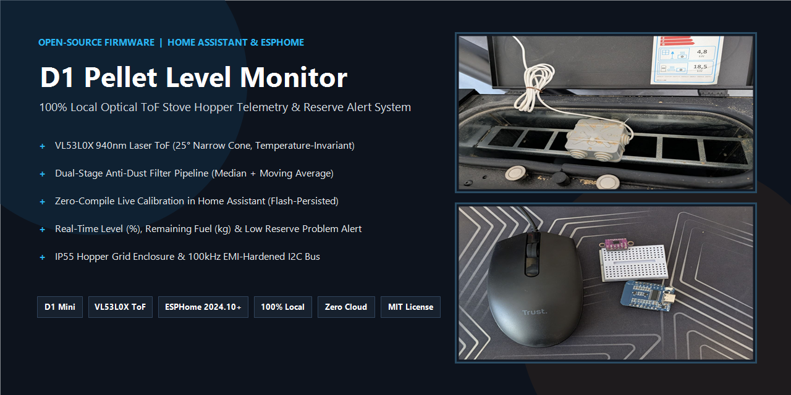
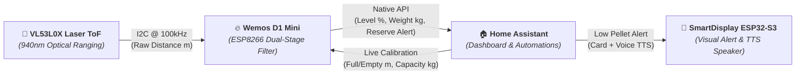

# 🔥 D1 Pellet Level Monitor (ESP8266 + VL53L0X ToF)

<p align="center">
  
</p>

[](https://github.com/pasmimmo/esphome-pellet-level/actions/workflows/ci.yml)
[](https://esphome.io)
[](https://home-assistant.io)
[](docs/ARCHITECTURE_DECISIONS.md)
[](CODE_OF_CONDUCT.md)
[](LICENSE)
[](docs/HARDWARE.md)

**D1 Pellet Level Monitor** is a modern, modular, open-source **ESPHome** firmware designed for the **Wemos D1 Mini (ESP8266)** and **VL53L0X Time-of-Flight (ToF) laser sensor** to accurately track pellet stove hopper levels, remaining fuel mass in kilograms, and low-reserve alerts in **Home Assistant**.

---

## 🗺️ System Overview & Architecture



---

## 📸 Real Hardware Showcase

<p align="center">
  
  
  
</p>

| 🧩 Ultra-Compact Electronics | 🛡️ IP55 Hopper Grid Mounting | 🚪 Clean Closed-Lid Routing |
| :---: | :---: | :---: |
| **Wemos D1 Mini (USB-C)** + **CJVL53L0XV2** laser module on a mini breadboard (mouse for scale) | Sealed **IP55 junction box** housing both D1 Mini and VL53L0X (bottom aperture aligned with the metal safety grid) | Power cable routed cleanly through the recessed lid handle slot without pinching the rubber seal |

---

## ✨ Key Features

* **🎯 Optical Time-of-Flight Precision (`VL53L0X`)**: Uses a $940\text{ nm}$ Class-1 eye-safe laser with a narrow $25^\circ$ Field of View (FoV), eliminating the false side-wall echoes and temperature drift typical of ultrasonic (`HC-SR04`) sensors.
* **🛡️ Dual-Stage Anti-Dust Filter Pipeline**:
  * **Stage 1 (`median`, window 5):** Completely rejects transient optical spikes caused by airborne sawdust clouds when pouring a bag of pellets.
  * **Stage 2 (`sliding_window_moving_average`, window 6):** Smooths out surface ripples and funnel avalanches as the auger feeds the stove.
* **🎛️ Live Calibration from Home Assistant (Zero Re-Compiling)**:
  * Adjust **Full Tank Distance (`100%`)**, **Empty Tank Distance (`0%`)**, **Tank Capacity (`kg`)**, and **Low Alert Threshold (`%`)** directly from the Home Assistant UI.
  * All parameters are automatically persisted in the ESP8266 flash (`restore_from_flash: true`).
* **⚖️ Remaining Fuel Weight & Hopper Status**:
  * Automatically computes **Remaining Pellet Weight (`kg`)** based on your hopper capacity.
  * Exposes a **Low Pellet Reserve** binary problem sensor and a human-readable **Hopper Status** text sensor (`Full`, `OK`, `Low`, `Reserve (Refill)`).
* **⚡ Instant Post-Refill Sampling**: Includes a **`Measure Pellet Level Now`** button in Home Assistant to trigger an immediate laser reading right after loading a bag of pellets without waiting for the 30-second polling interval.
* **🔌 Stove EMI Immunity & Thermal Efficiency**: Runs the I2C bus at a rock-solid $100\text{ kHz}$ with Wi-Fi `power_save_mode: LIGHT` to minimize ESP8266 heat dissipation inside the sealed IP55 enclosure.

---

## 🔧 Hardware & Wiring (`Wemos D1 Mini` ↔ `VL53L0X`)

| VL53L0X Pin | Wemos D1 Mini Pin | ESP8266 GPIO | Function |
| :---: | :---: | :---: | :--- |
| **VIN / VCC** | `3V3` | — | 3.3V Regulated Power |
| **GND** | `GND` | — | Common Ground |
| **SCL** | `D1` | `GPIO5` | I2C Clock ($100\text{ kHz}$) |
| **SDA** | `D2` | `GPIO4` | I2C Data |

👉 For optical cone math ($25^\circ\text{ FoV}$), IP55 junction box enclosure mounting on the hopper safety grid, and EMI tips, see **[Hardware & Optical Mounting Guide](docs/HARDWARE.md)**.

---

## 🚀 Quickstart

Want to get running in 3 minutes? See the **[⚡ 3-Step Quickstart Guide](docs/QUICKSTART.md)** or the **[Wiki](wiki/Home.md)**.

1. Copy [`secrets.yaml.example`](secrets.yaml.example) to `secrets.yaml` and fill in your Wi-Fi credentials (`wifi_ssid` and `wifi_password`).
2. Flash either:
   * **Modular version:** [`d1-livello-pellet.yaml`](d1-livello-pellet.yaml) + [`packages/`](packages/)
   * **Single-file version:** [`d1-livello-pellet_standalone.yaml`](d1-livello-pellet_standalone.yaml)
3. Open the device in Home Assistant and fine-tune your hopper distances under **Configuration**!

---

## 🏠 Home Assistant Entities Exposed

| Category | Entity Name | Type | Unit / Device Class | Description |
| :--- | :--- | :---: | :---: | :--- |
| **Telemetry** | `Pellet Level` | `sensor` | `%` | Clamped hopper fill level ($0\%\text{--}100\%$) |
| **Telemetry** | `Pellet Remaining` | `sensor` | `kg` (`weight`) | Estimated remaining pellets in kilograms |
| **Telemetry** | `Pellet Distance` | `sensor` | `m` | Filtered ToF laser distance from sensor to pellets |
| **Telemetry** | `Hopper Status` | `text_sensor` | — | `Full`, `OK`, `Low`, or `Reserve (Refill)` |
| **Alert** | `Low Pellet Reserve` | `binary_sensor` | `problem` | Turns `ON` when level $\le$ alert threshold |
| **Control** | `Measure Pellet Level Now` | `button` | — | Forces an immediate ToF sensor measurement |
| **Config** | `Full Tank Distance (100%)` | `number` | `m` | Distance when hopper is full (default `0.100 m`) |
| **Config** | `Empty Tank Distance (0%)` | `number` | `m` | Distance when hopper is empty (default `0.202 m`) |
| **Config** | `Tank Capacity` | `number` | `kg` | Total hopper capacity (default `15.0 kg`) |
| **Config** | `Low Pellet Alert Threshold` | `number` | `%` | Reserve warning threshold (default `20%`) |
| **Diagnostic** | `Wi-Fi Signal`, `Uptime`, `IP`, `MAC`, `SSID`, `ESPHome Version`, `Restart` | `sensor` / `text_sensor` / `button` | `diagnostic` | Full device health and remote reboot controls |

---

## 📊 Ready-to-Use Home Assistant Dashboard & Automations

* **Lovelace Dashboard Card**: Copy [`examples/home-assistant/dashboard_card.yaml`](examples/home-assistant/dashboard_card.yaml) into any Home Assistant dashboard for a complete Gauge + Live Calibration UI.
* **SmartDisplay & Mobile Automations**: Check [`examples/home-assistant/automations.yaml`](examples/home-assistant/automations.yaml) for ready-to-use automations including:
  1. **Low Reserve Alert** on **[SmartDisplay ESP32-S3](https://github.com/pasmimmo/SmartDisplay)** (visual card + TTS voice alert) and smartphone push notification.
  2. **Automatic Refill Detection** when pouring a new bag of pellets.
  3. **Evening Pre-Ignition Check** at 17:30.
  4. **Optical Lens Dust Maintenance Alert**.

---

## 🧠 Architecture Decision Records (ADR)

Engineering trade-offs and signal processing calculations are documented in **[`docs/ARCHITECTURE_DECISIONS.md`](docs/ARCHITECTURE_DECISIONS.md)**:

* **[ADR-01: Dual-Stage Median + SMA Filter Pipeline](docs/ARCHITECTURE_DECISIONS.md#adr-01-dual-stage-median--sma-filter-pipeline-for-sawdust-rejection)**: Mathematical proof of 50% breakdown-point outlier rejection against airborne sawdust clouds.
* **[ADR-02: Optical ToF (VL53L0X) vs Ultrasonic (HC-SR04)](docs/ARCHITECTURE_DECISIONS.md#adr-02-optical-time-of-flight-vl53l0x-vs-ultrasonic-ranging-hc-sr04)**: Temperature invariance and $25^\circ$ narrow cone analysis.
* **[ADR-03: I2C Bus Locked at 100 kHz for Stove EMI Immunity](docs/ARCHITECTURE_DECISIONS.md#adr-03-i2c-bus-frequency-locked-at-100-khz-for-stove-emi-immunity)**: Noise margin against $230\text{V AC}$ auger motor and igniter switching transients.
* **[ADR-04: Flash-Persisted Runtime Calibration](docs/ARCHITECTURE_DECISIONS.md#adr-04-flash-persisted-runtime-calibration-vs-hardcoded-lambda-constants)**: Zero-compile calibration persisted in ESP8266 flash.

---

## 📁 Repository Structure

```
.
├── .github/
│   ├── workflows/ci.yml                 # GitHub Actions: yamllint + ESPHome config check
│   ├── ISSUE_TEMPLATE/                  # Bug Report & Feature Request templates
│   ├── pull_request_template.md         # PR checklist & parity verification
│   └── assets/                          # Banner & real hardware installation photos
├── packages/                            # Modular ESPHome packages
│   ├── core.yaml                        # ESP8266 d1_mini, flash persistence, Wi-Fi, API, OTA
│   ├── pellet_sensor.yaml               # VL53L0X ToF, dual-stage filter, live calibration, kg/status
│   └── diagnostics.yaml                 # Wi-Fi RSSI, IP/MAC/SSID, Uptime, Measure Now & Restart
├── examples/home-assistant/             # Ready-to-use Home Assistant integrations
│   ├── automations.yaml                 # Reserve alerts (SmartDisplay + TTS + Mobile), refill log
│   └── dashboard_card.yaml              # Lovelace Gauge + Live Calibration panel
├── docs/                                # Technical documentation
│   ├── QUICKSTART.md                    # 3-step rapid setup guide
│   ├── HARDWARE.md                      # Pinout, 25° FoV optical math, IP55 hopper grid mount
│   └── ARCHITECTURE_DECISIONS.md        # Engineering ADRs (ADR-01 to ADR-04)
├── wiki/                                # GitHub Wiki documentation pages
├── d1-livello-pellet.yaml               # Modular entrypoint (with substitutions)
├── d1-livello-pellet_standalone.yaml    # Standalone all-in-one file (single-file install)
├── secrets.yaml.example                 # Sanitized credentials template
├── requirements-ci.txt                  # Python dependencies for CI pipeline
├── .yamllint.yml                        # YAML linting rules
├── CONTRIBUTING.md                      # Contributor guidelines
├── CODE_OF_CONDUCT.md                   # Contributor Covenant v2.1
├── RELEASE_NOTES.md                     # Release changelog (v1.0.0)
├── TODO.md                              # Project roadmap & completed checklist
└── LICENSE                              # MIT License
```

---

## 👥 Credits & Maintainers

* **[pasmimmo](https://github.com/pasmimmo)**: Hardware design, stove enclosure integration, and maintainer.
* **[Antigravity](https://github.com/google-deepmind)** (Google DeepMind): AI pair programming partner, dual-stage filter architecture, optimizations & documentation.
* Built with the power of [ESPHome](https://esphome.io) and [Home Assistant](https://www.home-assistant.io/).
