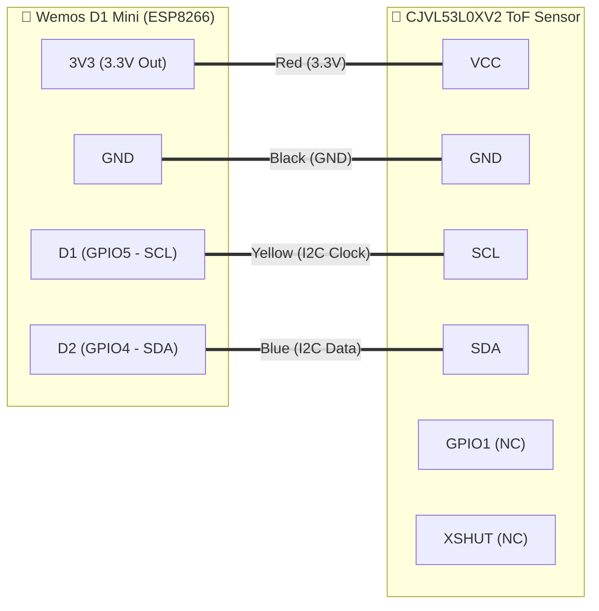

# 🔧 Hardware Reference, Pinout & Optical Mounting Guide

Complete hardware documentation for the **D1 Pellet Level Monitor** based on the **Wemos D1 Mini (ESP8266)** and **STMicroelectronics VL53L0X** (`CJVL53L0XV2`) Time-of-Flight (ToF) laser ranging module.

---

## 1. Hardware Specifications & Bill of Materials (BOM)

  

| Component | Specification |
| :--- | :--- |
| **Microcontroller Board** | Wemos (LOLIN) D1 Mini (USB-C) — ESP8266EX @ 80 MHz, 4 MB Flash |
| **ToF Ranging Sensor** | STMicroelectronics VL53L0X (`CJVL53L0XV2`, 940 nm VCSEL Eye-Safe Class 1 Laser) |
| **Enclosure** | Compact IP55/IP65 Electrical Junction Box ($\approx 80 \times 80 \times 40\text{ mm}$) |
| **Fastening** | 2x Nylon zip-ties anchored to the hopper metal safety grid |
| **Measurement Principle** | Optical Time-of-Flight (photon travel time — independent of pellet color/reflectance) |
| **Effective Range** | $0.03\text{ m}$ ($3\text{ cm}$) to $1.20\text{ m}$ ($120\text{ cm}$) |
| **Field of View (FoV)** | $25^\circ$ conical sensing zone |
| **Interface** | I2C Bus @ $100\text{ kHz}$ ($3.3\text{V}$ logic) |
| **Power Supply** | $5\text{V}$ via USB-C cable ($\approx 70\text{ mA}$ average with Wi-Fi Light Sleep) |

---

## 2. Complete Wiring & Pinout

### Pin Mapping Table

| Wemos D1 Mini Label | ESP8266 GPIO | CJVL53L0XV2 Pin | Electrical Notes |
| :---: | :---: | :---: | :--- |
| **3V3** | — | **VCC** | Powered from onboard 3.3V LDO regulator (max $500\text{ mA}$) |
| **GND** | — | **GND** | Common ground reference |
| **D1** | `GPIO5` | **SCL** | I2C Clock ($100\text{ kHz}$) with onboard pull-up resistor |
| **D2** | `GPIO4` | **SDA** | I2C Data with onboard pull-up resistor |
| — | — | **GPIO1** | Leave unconnected (interrupt pin not required in polled mode) |
| — | — | **XSHUT** | Leave unconnected (pulled HIGH internally on breakout) |

---

## 3. Real-World Enclosure & Hopper Grid Mounting

  
  

### Why Mount inside an IP55 Junction Box on the Hopper Safety Grid?

1. **Complete Dust Protection for Electronics**:
   - Both the **Wemos D1 Mini** and the **VL53L0X** sensor are housed inside a sealed **IP55 plastic junction box** using a mini breadboard.
   - A small circular aperture ($\varnothing\,8\text{--}10\text{ mm}$) is drilled into the **bottom face** of the junction box directly beneath the VL53L0X optical window.
   - This shields the ESP8266, USB-C connector, and jumper wires from abrasive wood dust when pouring $15\text{ kg}$ bags of pellets.
2. **Rigid Alignment Above the Auger Intake**:
   - The IP55 junction box is fastened with two crossed nylon zip-ties onto the stove's **galvanized steel safety grid** (`griglia salvamano`), centered over one of the square openings so the laser beam has an unobstructed vertical path down to the bottom of the hopper.
   - Because the box rests on the fixed internal grid rather than the hinged lid, the measurement reference distance remains **100% constant** whether the lid is open or closed!
3. **Zero-Pinch Cable Routing**:
   - A service loop of USB cable is tied near the hinge, and the cable exits cleanly through the **recessed handle cutout** of the top lid without compressing or damaging the stove's airtight perimeter rubber gasket.

---

## 4. Optical Geometry ($25^\circ\text{ FoV}$)

Unlike ultrasonic sensors (`HC-SR04`) that suffer from wide acoustic cones and false echoes off metal hopper walls, the **VL53L0X** uses a narrow $940\text{ nm}$ invisible laser cone with a **$25^\circ$ Field of View (FoV)**.

At any distance $d$ from the sensor lens, the diameter $D_{\text{spot}}$ of the laser measurement circle is:

$$D_{\text{spot}} = 2 \cdot d \cdot \tan\left(\frac{25^\circ}{2}\right) \approx 0.443 \cdot d$$

| Distance from Lens ($d$) | Laser Spot Diameter ($D_{\text{spot}}$) | Minimum Clearance from Hopper Wall ($r = D_{\text{spot}}/2$) |
| :---: | :---: | :---: |
| **$0.10\text{ m}$ ($10\text{ cm}$ - Full)** | $4.4\text{ cm}$ | $\ge 2.5\text{ cm}$ from side walls |
| **$0.20\text{ m}$ ($20\text{ cm}$ - Empty)** | $8.9\text{ cm}$ | $\ge 4.5\text{ cm}$ from side walls |
| **$0.40\text{ m}$ ($40\text{ cm}$)** | $17.7\text{ cm}$ | $\ge 9.0\text{ cm}$ from side walls |

### Maintenance Tip
* Every 1–2 months during routine stove vacuuming, gently wipe the bottom optical aperture of the junction box with a dry cotton swab or microfiber cloth to remove any accumulated fine sawdust film.
