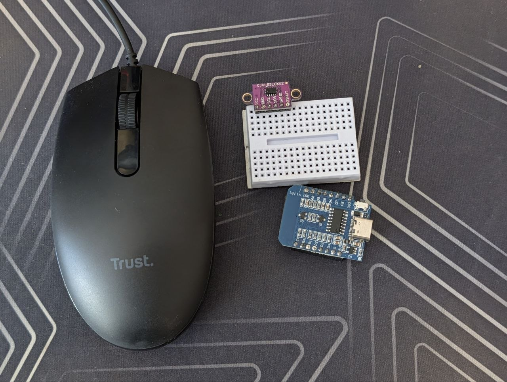
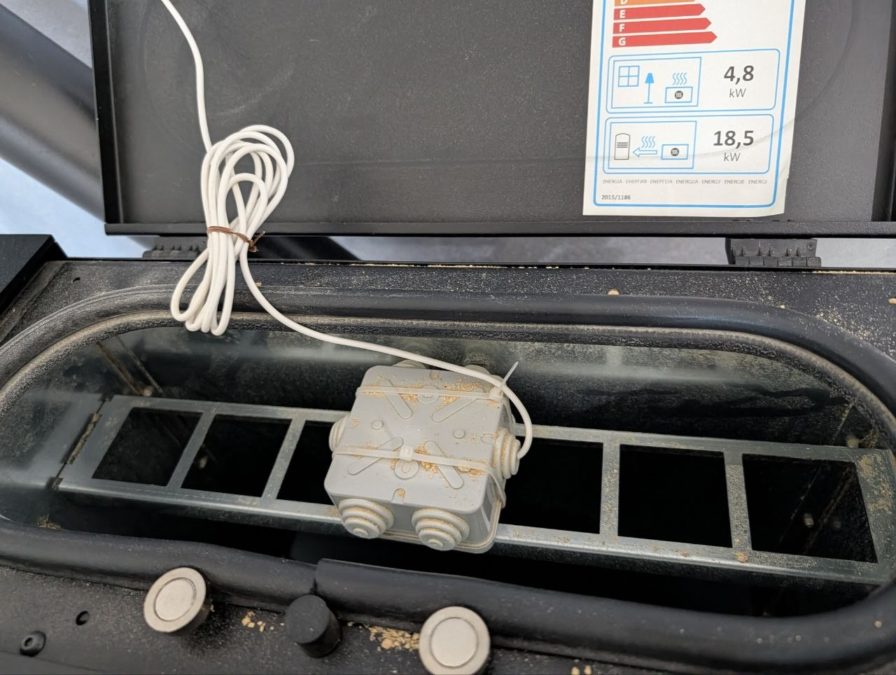
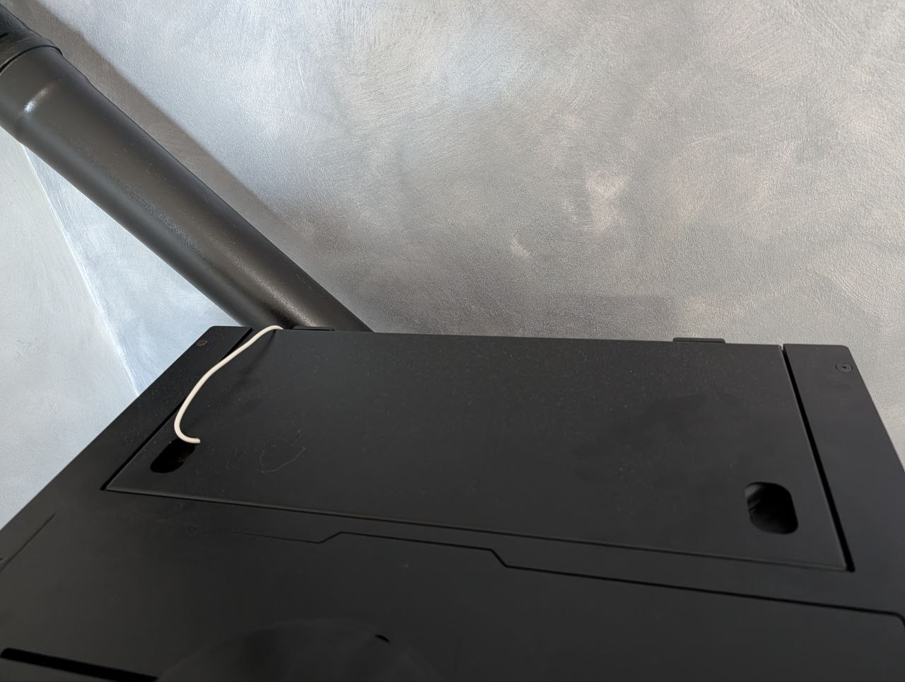

# 🔧 Hardware, Pinout & IP55 Hopper Mounting

## 1. Electronic Components

  

* **MCU**: Wemos D1 Mini (ESP8266, USB-C)
* **Sensor**: `CJVL53L0XV2` (`VL53L0X` 940 nm Class-1 Laser ToF)
* **Enclosure**: Sealed IP55 electrical junction box with an $8\text{--}10\text{ mm}$ bottom aperture for the laser window

---

## 2. Hopper Grid Mounting & Cable Routing

  
  

* Fasten the IP55 junction box directly onto the **metal safety grid** (`griglia salvamano`) using two crossed nylon zip-ties, aligning the bottom laser hole with one of the grid squares.
* Leave a service cable loop near the lid hinge so the lid opens freely during pellet refills.
* Route the USB power cable out through the **recessed lid handle slot** to avoid pinching the stove's rubber perimeter gasket.
